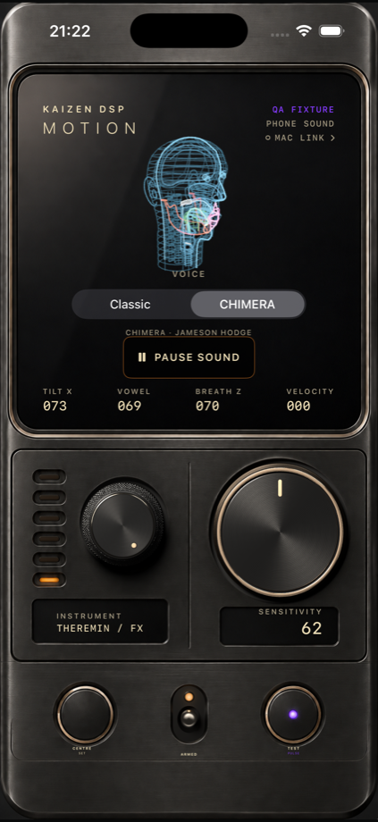

# Kaizen Motion

An open-source motion instrument: shake, tilt and rotate an iPhone or iPad to play percussion, a continuous Theremin, or CHIMERA's physical vocal synth. Includes an AUv3 MIDI processor and a Mac bridge for wireless MIDI and local sound.

**Development beta.** Shaker feel and texture are being tuned on physical hardware. This is not a finished release. iOS and Apple Silicon macOS have engineering builds; Android and Windows apps are planned, not delivered. The AUv3 is MIDI-only and requires a compatible instrument/host route.



*Simulator fixture showing the native CHIMERA anatomy; synthetic motion, not a physical device acceptance test.*

## Play in your browser

**[Open the Motion web demo](https://kaizen-motion.kaizenstrate-5328.chatgpt.site)** — no install or account. Starts on the real CHIMERA WASM voice with live 3D anatomy. Synths include Theremin, Velvet, Glass, Orbit and Reed. The Shaker uses audio-clock XYZ grain contacts; the display shows the same particles. Enable motion on a supported phone, or use touch/mouse controls. Browser latency and sensor behavior still need physical acceptance; this demo has no native Mac link or AUv3 hosting. Web source and build instructions are in [`WebMotion`](WebMotion/README.md).

## Instruments

- **Shaker:** loose XYZ grains inside a box, circle or oval; adjustable dimensions, grain size and count. Contact-local pulses show collisions. Continuous measured shaking effort drives overlapping recorded grains, without beat quantization.
- **Tambourine, Maraca, Cabasa and Hand Drum:** directional or rotational gestures drive percussion.
- **Classic Theremin:** continuous X pitch, Y vowel/formant colour, with pause/resume.
- **CHIMERA:** Jameson Hodge's native physical vocal model; X pitch, Y OO–AH–EE and Z effort. Its actual 3D anatomical head replaces the motion dots, follows the native articulators, and supports drag rotation.

Phone sound runs locally. The network sends musical events and controls, never audio. The Mac bridge advertises via Bonjour and exposes a CoreMIDI source. The separate Mac listening tool renders the received instrument.

## Build on an Apple Silicon Mac

Requires Xcode with the iOS SDK, XcodeGen, Rust 1.88.0 and Bun. Install tools from their official distributions, then:

```sh
rustup toolchain install 1.88.0
rustup +1.88.0 target add aarch64-apple-darwin aarch64-apple-ios aarch64-apple-ios-sim
scripts/build_chimera_native.sh
bun install --cwd Renderer/Chimera --frozen-lockfile
bun run --cwd Renderer/Chimera build
swift test --package-path Packages/MotionCore
xcodegen generate
xcodebuild -project KaizenMotion.xcodeproj -scheme KaizenMotion \
  -configuration Debug -destination 'generic/platform=iOS Simulator' \
  ARCHS=arm64 CODE_SIGNING_ALLOWED=NO build
```

Open the generated Xcode project to install on your own phone. Select your development team for both targets and use bundle identifiers registered to that team. Signing accounts, provisioning profiles, generated native binaries and private device/session logs are not part of the repository. Intel simulator and Mac binaries are not currently packaged by the native build script.

```sh
swift run --package-path Packages/MotionCore KaizenMotionBridge
# In a second terminal:
swift run --package-path Packages/MotionCore KaizenMotionListen --built-in --low-latency
```

On the phone, open the output status panel, find the Mac on the same local network and select it. This engineering transport has no authenticated pairing; use it on a trusted local network. The listening tool has no app window. `--output-name 'Device Name'` selects another Mac audio output.

## Source layout

- `App`, `SharedPlatform`, `SharedUI`: native Swift app, sensing, networking and interface.
- `Extension`: AUv3 MIDI processor.
- `Packages/MotionCore`: gesture analysis, MIDI protocol, tests, bridge and listening tool.
- `Packages/MotionCore/Sources/MotionToneDSP`: bounded real-time C percussion and Classic Theremin.
- `Packages/MotionChimeraNative`: native Rust adapter and pinned upstream vocal engine.
- `Renderer/Chimera`: pinned upstream 3D drawing code and local Three.js bundle builder. No browser audio engine or remote assets.
- `Assets`: editable Blender controls, render scripts and attributed recorded shaker sources.
- `portable`: standalone C audio boundary and C++ ABI check. This is groundwork for other platforms, not an Android/Windows app.

## Checks

The initial public snapshot passes 65 Swift tests, two Rust real-time/audio tests, and an arm64 iOS simulator/device archive build. The 3D head has been visually checked in the simulator using explicitly synthetic motion. These checks do not establish physical playing feel, named DAW compatibility or acceptance on other platforms.

```sh
cargo +1.88.0 test --manifest-path Packages/MotionChimeraNative/Cargo.toml
cmake -S portable -B build/portable -DCMAKE_BUILD_TYPE=Release
cmake --build build/portable
ctest --test-dir build/portable --output-on-failure
```

## License and credits

Motion's original source and project-created assets are MIT licensed; see [LICENSE](LICENSE). Third-party components retain their own licenses. The Kaizen names and logos are not a trademark grant.

- [CHIMERA by Jameson Hodge](https://github.com/jamesondh/chimera-vocal-synth), MIT, pinned at `dd68078730126c50cd119b18b3889e414c4f4528`. Its license is retained beside the native engine and renderer.
- [Three.js](https://github.com/mrdoob/three.js), MIT, version 0.186.1; license bundled in `App/Resources/ChimeraHead/THREE-LICENSE.txt`.
- Recorded shaker sources by el_boss, Sadiquecat and Joseph SARDIN are CC0. Exact sources, hashes and excerpt provenance are in `Assets/Audio/Shaker/sources.json` and `bank.json`.
- Rust dependency license texts are in `LICENSES`. Upstream licenses take precedence for their components.

Issues and contributions are welcome. For sound/gesture bugs include the device, selected instrument, motion performed and whether the issue affects phone sound, Mac sound or MIDI. Never include signing credentials or provisioning profiles.
